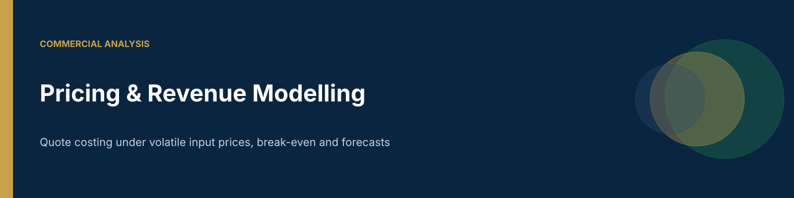
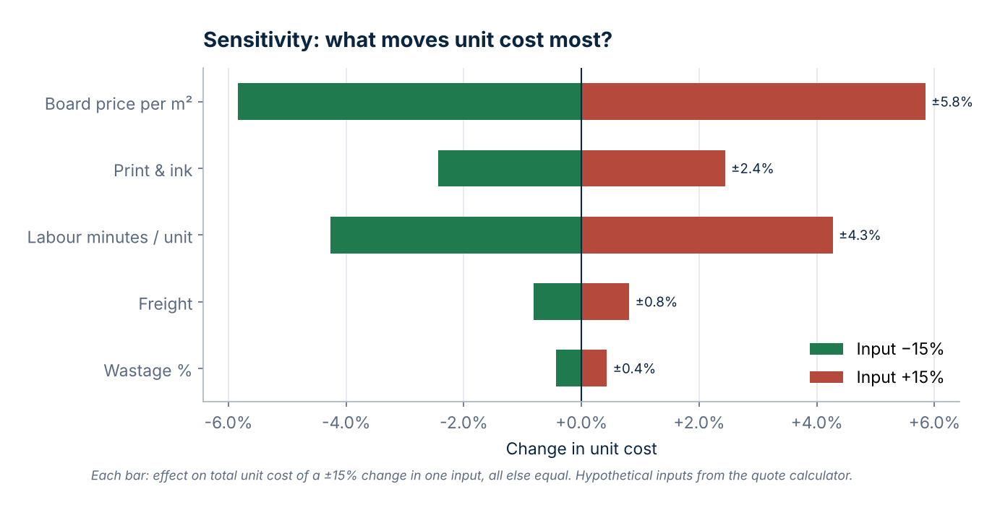
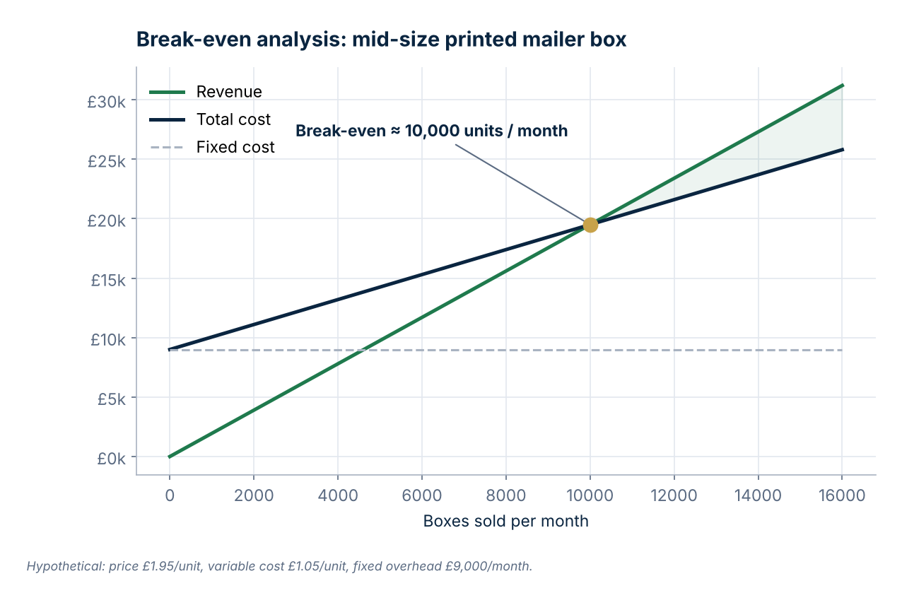
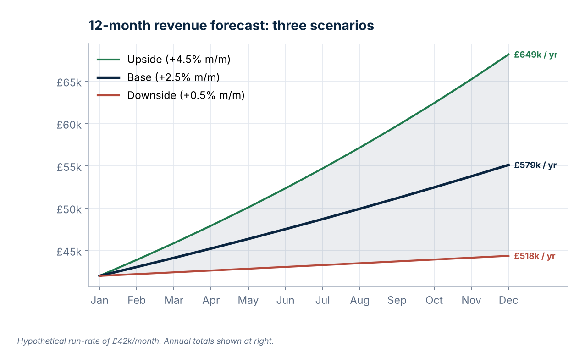

# Pricing & Revenue Modelling

**How do you quote profitably when your main input cost changes every day?** This project builds a quote-costing calculator, a volume price ladder with a margin floor, a break-even model and a 12-month scenario forecast for a manufacturer of printed mailer boxes.

> **Data note.** All prices, costs and volumes are **hypothetical**. The approach reflects the kind of problem I worked on during a business strategy internship with a UK packaging company, but no company data, prices or clients are used here.

---

## 1. The business problem

For a packaging manufacturer, paperboard is the largest single cost. When board prices move daily, a fixed price list either loses margin when costs rise or loses deals when costs fall. Sales teams also give volume discounts without knowing where margin runs out.

## 2. Objectives

1. Cost every quote from current input prices in seconds.
2. Set volume tiers that reward larger orders **without** going below a margin floor.
3. Know the monthly volume needed to break even and to hit a profit target.
4. Forecast revenue under downside, base and upside scenarios.

## 3. Model structure

```
Inputs (yellow)          Calculations                     Outputs
──────────────           ────────────                     ───────
Board price / m²   ─┐
Blank area, waste   ├─► Board cost per box ─┐
Print, freight,     │                       ├─► Unit cost ─► Base price at target margin ─► Tiered price ladder
overhead            ┘   Labour per box ─────┘                                                + margin check per tier
Fixed costs, price ───► Contribution per box ─► Break-even volume & revenue
Run-rate, growth   ───► 12-month scenario forecast
```

## 4. Analysis

### Unit cost and the price ladder (sample inputs)

| Component | £ per box |
|---|--:|
| Board (0.42 m² × £0.95, +8% waste) | 0.431 |
| Print & ink | 0.180 |
| Labour (0.9 min at £21/hr) | 0.315 |
| Freight | 0.060 |
| Overhead absorption | 0.120 |
| **Unit cost** | **1.106** |
| **Base price at 35% margin** | **1.701** |

| Quantity | Discount | Unit price | Gross margin |
|--:|--:|--:|--:|
| 250 | 0% | £1.70 | 35.0% |
| 1,000 | 9% | £1.55 | 28.6% |
| 5,000 | 16% | £1.43 | 22.6% |
| 10,000 | 19% | £1.38 | **19.8%** ⚠ |

The 10,000-unit tier breaks the 20% margin floor. The model flags it red, so a salesperson can see the problem before the quote goes out.

### Sensitivity: what moves cost most



A ±15% move in board price shifts total unit cost by **±5.8%**, the largest of any driver, followed by labour minutes per box (±4.3%). Labour is controllable through process; board price is not, and it moves daily. **Board price is the input to watch every day; labour productivity is the lever to work on.**

### Break-even



With a £1.95 average price, £1.05 variable cost and £9,000 monthly fixed cost, break-even is **10,000 boxes a month**. A £3,000 monthly profit target needs about 13,300.

### Revenue scenarios



| Scenario | Growth m/m | 12-month revenue |
|---|:-:|--:|
| Downside | 0.5% | ≈ £518k |
| Base | 2.5% | ≈ £579k |
| Upside | 4.5% | ≈ £649k |

## 5. Recommendations

1. **Index quotes to board price.** Quote validity of 7 days, re-costed from the current board price.
2. **Enforce a 20% margin floor** on every tier; deeper discounts need commercial sign-off.
3. **Plan capacity and cash on the base case**, but agree in advance what triggers a cost review if actuals track the downside for two months.
4. **Review the ladder quarterly** against actual order mix and win rates.

## 6. Deliverables

| File | Contents |
|---|---|
| [`templates/pricing-and-revenue-model.xlsx`](templates/pricing-and-revenue-model.xlsx) | **Quote calculator** with price ladder and margin flags · **Break-even** (incl. volume for target profit) · **Forecast** with three scenarios and chart |

## 7. How to use

1. Update **board price (today)** on the Quote calculator; every price recalculates.
2. Change tier discounts and watch the margin column; red means below 20%.
3. Enter your fixed costs and average price on **Break-even**.
4. Set run-rate and growth assumptions on **Forecast** to stress-test plans.

---

<sub>Prepared by <a href="https://github.com/sohaibshabbir9-del">Sohaib Shabbir</a> · Commercial analysis & pricing · Hypothetical figures for portfolio purposes.</sub>
